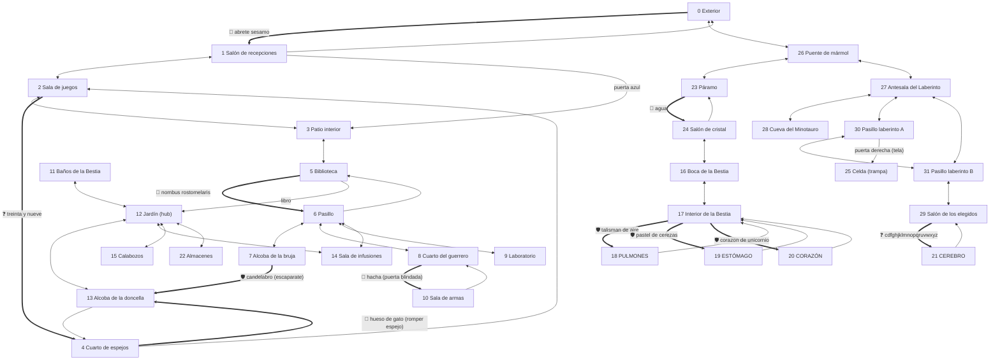

# La Fortaleza 1 — Mapa (según el port C++)

> Fuente: `fortaleza1/src/WorldData.cpp`. 32 habitaciones (ids 0–31).
> **Ojo:** este mapa describe el *port*, no está verificado 1:1 contra `FORT1.EXE` (ver `DISENO.md` §6).

## Leyenda
- `-->` paso abierto · `==>` paso que requiere algo (clave/acertijo/objeto) · `x` muerte
- 🔑 clave o palabra · ❓ acertijo · 🛡 objeto obligatorio para cruzar (si no, muerte)

## Grafo

## Tabla de habitaciones

| id | Lugar | Objetos (peso) | Criaturas → pide / da |
|---|---|---|---|
| 0 | Exterior | Roble(fijo), Maza 39, Pastel de cerezas 2 | Llamador de bronce → cigarro / "Rumpelstinskin" |
| 1 | Salón de recepciones | Retrato 1 | Mendigo → vaso de agua / pista doncella-espejo |
| 2 | Sala de juegos | Escoba 1, Inscripción(fija), Hilo de Ariadna 1 | — |
| 3 | Patio interior | Balanza 5 | Atenea → lanza / pista talismán · Arpía → paraguas / pista libro |
| 4 | Cuarto de espejos | Hueso de gato 1 | — |
| 5 | Biblioteca | Vaso de agua 1, Candelabro 1 | — |
| 6 | Pasillo | Antorcha 1 | — |
| 7 | Alcoba de la bruja | Polvo mágico 1, Poción para crecer 5 | Bruja → pastel / pista "Prohibido → luz" |
| 8 | Cuarto del guerrero | Vendajes 3, Grabado 3 | — |
| 9 | Laboratorio | Piedra filosofal 10, Máquina del tiempo 3 | Homúnculo → poción / pista candelabro |
| 10 | Sala de armas | Espada 5, Lanza 10, Arco 5, Daga 3, Ariete(fijo), Látigo 2 | — |
| 11 | Baños | Rosa 1, Inscripción 2, Espejo(fijo) | Troll → polvo mágico / pista unicornio |
| 12 | Jardín | Inscripción 1, Cedro(fijo) | — |
| 13 | Alcoba de la doncella | Cuadro 10, Corazón de unicornio 1 | Doncella → rosa / pista alfabeto |
| 14 | Sala de infusiones | Taza de café 1, Cigarro 1 | Anciano → café / pista espada+látigo |
| 15 | Calabozos | Paraguas 2, Talismán de aire 1 | Prisionero → vaso de agua / pista pastel |
| 16 | Boca de la Bestia | — | — |
| 17 | Interior de la Bestia | Inscripción(fija) | — |
| 18 | Pulmones | — | Centro pulmones (muere con **espada**) |
| 19 | Estómago | — | Centro estómago (muere con **látigo**) |
| 20 | Corazón | — | Centro corazón (muere con **daga**) |
| 21 | Cerebro | — | Centro cerebro (muere con **antorcha**) |
| 22 | Almacenes | Hacha 10 | Verdugo → piedra filosofal / pista "agua" |
| 23 | Páramo | — | — |
| 24 | Salón de cristal | Columna de cristal(fija) | — |
| 25 | Celda pequeña | Inscripción(fija) | **Trampa: fin de partida** |
| 26 | Puente de mármol | Martillo 2 | — |
| 27 | Antesala del Laberinto | — | — |
| 28 | Cueva del Minotauro | Antorcha 1…7 (2 c/u) | Minotauro (muere con espada) |
| 29 | Salón de los elegidos | — | — |
| 30–31 | Pasillos del Laberinto | — | — |

Capacidad de carga: **40 bolsas**.

## Ruta mínima de victoria (port actual)

1. `abrir puerta principal diciendo abrete sesamo` → 1 → 3 → 5 → `ir libro` → 12 (Jardín)
2. 22: `coger hacha` · 15: `coger talisman` · 13: `coger corazon de unicornio`
3. 14 → 6: `coger antorcha` → 8: `romper puerta con hacha` → 10: `coger espada`, `daga`, `latigo`
4. Volver a 0: `coger pastel` → 26 → 23: `abrir puerta de agua diciendo agua` → 24 → 16 → 17
5. 18/19/20: `matar centro con espada|latigo|daga`
6. 16 → 24 → 23 → 26 → 27 → 31 → 29: `abrir puerta dorada respondiendo cdfghjklmnopqruvwxyz`
7. 21: `matar centro del cerebro con antorcha` → **victoria**
