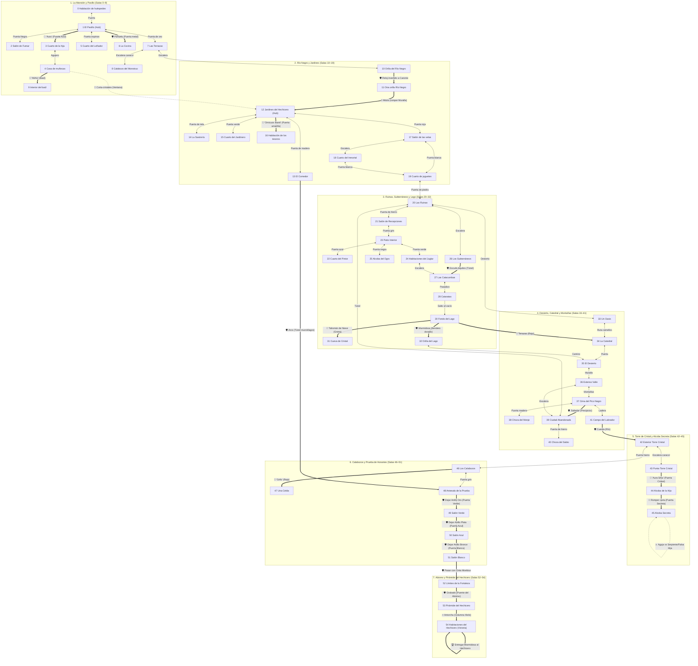

# La Fortaleza 2: La venganza de la Bestia — Mapa Completo

> Extraído directamente de `FORT2.EXE` desempaquetado (55 habitaciones, IDs 0–54).
> Obra de Miguel Enrique Cepero (1990/1991), Merchise Software.

---

## 1. Zonas Principales de la Fortaleza 2

1. **La Mansión / Residencia Inicial (Salas 0–9):**
   - 0: Habitación para huéspedes (inicio)
   - 1: El pasillo (hub de 6 puertas)
   - 2: El Salón de Fumar (tentáculos, sillas, balanza)
   - 3: Cuarto de la hija del Hechicero
   - 4: Casa de muñecas y baúl dimensional
   - 5: Cuarto del Leñador
   - 6: La Cocina (matadero con marcas de mano de 7 dedos)
   - 7: Las Terrazas (gravedad invertida, escalera no euclidiana)
   - 8: Calabozo del Monstruo
   - 9: Interior del baúl

2. **El Río Negro y los Jardines (Salas 10–19):**
   - 10: Orilla del Río Negro (Caronte y su bote)
   - 11: Otra orilla del Río Negro (Muralla colosal, árbol de marfil)
   - 12: Los Jardines del Hechicero (hub central vegetal)
   - 13: El Comedor (mesa gigante, túnel con murciélagos)
   - 14: La Sastrería (telas de araña, aguja de plata)
   - 15: Cuarto del Jardinero
   - 16: Habitación de los tesoros (Omicuos Ihanti)
   - 17: Salón de las velas
   - 18: Cuarto del Inmortal
   - 19: Cuarto de juguetes

3. **Las Ruinas, Subterráneos y el Lago Subterráneo (Salas 20–32):**
   - 20: Las Ruinas (cruce entre desierto, catacumbas y juguetes)
   - 21: Salón de Recepciones del Ogro
   - 22: Cuarto del Pintor
   - 23: Patio Interior invernal
   - 24: Habitaciones del Juglar
   - 25: Alcoba del Ogro
   - 26: Los Subterráneos
   - 27: Las Catacumbas ("Este es para ti")
   - 28: Cataratas (inicio)
   - 29: Bajos de las cataratas
   - 30: Fondo del Lago (respiración acuática, Doncella del Lago)
   - 31: Cueva de Cristal (espada Marmidosa)
   - 32: Orilla del Lago

4. **El Desierto, la Catedral y las Montañas (Salas 33–41):**
   - 33: Un Oasis (pordiosero, palmeras de dátiles)
   - 34: La Catedral (Obispo)
   - 35: El Desierto
   - 36: Un extenso valle (árboles que se cultivan solos)
   - 37: Cima del Pico Negro (nieve y abismo)
   - 38: Choza del Monje (cuentas de rosario)
   - 39: La Ciudad Abandonada (eco de gente y cocinas)
   - 40: Choza del Sabio (Cinta de Moebius y esqueletos)
   - 41: Campo cultivado del Labrador

5. **La Torre de Cristal y la Alcoba Secreta (Salas 42–45):**
   - 42: Exterior de la Torre de Cristal (río caudaloso)
   - 43: Punta de la Torre de Cristal (tablilla con acertijo)
   - 44: Alcoba de la hija del Hechicero
   - 45: Alcoba Secreta (la verdadera hija: serpiente de 3 cabezas)

6. **Los Calabozos y la Prueba de los Horantes (Salas 46–51):**
   - 46: Los Calabozos (Carcelero)
   - 47: Celda de castigo (Encapuchado de 7 extremidades)
   - 48: Antesala de la Prueba (vitrales rojos)
   - 49: Salón Verde (dejar anillo de oro)
   - 50: Salón Azul (dejar anillo de plata)
   - 51: Salón Blanco (dejar anillo de bronce, pasar con Cinta de Moebius)

7. **El Abismo y la Pirámide del Hechicero (Salas 52–54):**
   - 52: Límites de la Fortaleza (Guardián, Tercera Muralla)
   - 53: Pirámide del Hechicero (columna de hielo)
   - 54: Habitaciones del Hechicero (Hechicero con vara de calavera)

---

## 2. Diagrama del Mapa (Grafo Mermaid)

### Leyenda
- `<-->` paso bidireccional abierto · `-->` paso unidireccional
- `==>` paso con requerimiento obligatorio (muerte si se infringe)
- 🔑 clave o palabra mágica · ❓ acertijo · 🛡 objeto necesario para pasar/sobrevivir
- ⚔️ combate con arma específica · 🔨 rotura/interacción con objeto

---

## 3. Tabla Detallada de Habitaciones, Objetos y Criaturas

| ID | Nombre | Objetos / Peso | Criaturas (Pide / Confesión / Arma) | Salidas Principales |
|---|---|---|---|---|
| 0 | Habitación de huéspedes | — | — | Puerta → 1 |
| 1 | El pasillo | — | Grifo (muere con Daga → "¡Aura!") | Puerta → 0, Espinos → 5, Metal (Pañuelo) → 6, Negra → 2, Azul ("Aura") → 3, Oro → 7 |
| 2 | Salón de Fumar | Balanza (5), Inscripción (1) | — | Puerta Negra → 1 |
| 3 | Cuarto de la hija | Pañuelo (1), Carta (1) | — | Puerta Azul → 1, Agujero → 4 |
| 4 | Casa de muñecas | — | — | Agujero → 3, Ventana (Corta-cristales) → 12, Baúl ("MIAU") → 9 |
| 5 | Cuarto del Leñador | Daga (4), Botella de vino (15), Hacha (5) | — | Puerta de espinos → 1 |
| 6 | La Cocina | Receta (6), Muslo de carnero (16), Pescado (7) | — | Puerta de metal → 1 |
| 7 | Las Terrazas | Reloj de arena (14), Silla (5) | — | Puerta de oro → 1, Escalera → 8 y 10 |
| 8 | Calabozo del Monstruo | Inscripción (1) | Monstruo (Pide comida / Pista Marmidosa) | Escalera → 7 |
| 9 | Interior del baúl | Inscripción (1), Piedra verde (12) | Gato (Pide Pescado / Pista piedra verde) | Puerta del baúl → 4 |
| 10 | Orilla del Río Negro | Bote (1) | Caronte (Pide Reloj de arena invertido / Pista blanco) | Escalera → 8, Río Negro → 11 |
| 11 | Otra orilla Río Negro | Maza (4) | — | Río Negro → 10, Muralla (Maza) → 12, Árbol marfil (Hacha) |
| 12 | Jardines del Hechicero | Piedra (1) | Jardinero (Pide Hacha / Pista anillos) | Comedor → 13, Tesoro → 16, Sastrería → 14, Cuarto Jardinero → 15, Velas → 17, Avenida → 11 |
| 13 | El Comedor | Huevo (5), Tiranosaurio (10) | Cachorro dinosaurio (Sonajero / Pista gato) | Puerta → 12, Túnel (Arco) → 48, Huevo (Piedra) |
| 14 | La Sastrería | Muñeco diabólico (16), Aguja (5) | — | Puerta de tela → 12 |
| 15 | Cuarto del Jardinero | Sombrero (8), Rosa diamante (13) | — | Puerta verde → 12 |
| 16 | Habitación de los tesoros | Anillo de oro (13), Arpa (4), Bolsa de oro (5) | — | Puerta amarilla ("Omicuos Ihanti") → 12 |
| 17 | Salón de las velas | — | Dragón (Pide comida / Clave tesoro) | Puerta roja → 12, Escalera → 18 |
| 18 | Cuarto del Inmortal | — | Inmortal (Pide vino / Pista tercera barrera) | Escalera → 17, Puerta blanca → 19 |
| 19 | Cuarto de juguetes | Saltador (8), Sonajero (2), Talismán de Nieve (17) | — | Puerta blanca → 18, Puerta piedra → 20 |
| 20 | Las Ruinas | — | — | Juguetes → 19, Hierro → 21, Escalera → 26, Desierto → 33 |
| 21 | Salón de Recepciones | Anillo de bronce (16) | — | Ruinas → 20, Patio → 23, Pintor → 22, Juglar → 24 |
| 22 | Cuarto del Pintor | Lienzo (6), Grabado (7) | — | Salón Recepciones → 21 |
| 23 | Patio Interior | — | — | Recepciones → 21, Alcoba Ogro → 25 |
| 24 | Habitaciones del Juglar | Cuerda con gancho (6) | Juglar (Pide Arpa / Pista fragua de Vulcano) | Salón Recepciones → 21 |
| 25 | Alcoba del Ogro | — | Ogro (Muere con Cubo de agua / Pista Marmidosa) | Patio → 23, Catacumbas (Escudo Aquiles) → 27 |
| 26 | Los Subterráneos | Antorcha (8) | — | Ruinas → 20, Catacumbas (Escudo Aquiles) → 27 |
| 27 | Las Catacumbas | Esqueleto murciélago (23), Anillo de plata (15) | — | Subterráneos → 26, Catarata → 28 |
| 28 | Inicio de Cataratas | — | — | Salto al vacío → 30 (fondo del Lago) |
| 29 | Bajos de cataratas | — | — | Paso hacia el lago |
| 30 | Fondo del Lago | Inscripción (1) | Doncella del Lago (Pide Talismán Nieve / Pista manuscrito) | Grieta (Talismán Nieve) → 31, Reja (Tenazas) → 34, Sendero dorado (Marmidosa) → 32 |
| 31 | Cueva de Cristal | Marmidosa (espada legendaria) | — | Grieta → 30 |
| 32 | Orilla del Lago | — | — | Sendero dorado → 30, Camino → 35 |
| 33 | Un Oasis | Cubo de agua (12) | Pordiosero (Pide bolsa oro / "Si el Ogro se baña, se muere") | Ruinas → 20, Catedral (Camellos) → 34 |
| 34 | La Catedral | Rosario (7) | Obispo (Pide Silla / Pista Talismán Nieve) | Oasis → 33, Desierto → 35 |
| 35 | El Desierto | Escudo de Aquiles (17) | — | Avenida flores → 35, Montañas → 37, Lago → 32, Catedral → 34 |
| 36 | Extenso Valle | — | Camello (Pide semillas / Pista nombre hija: termina en "KA") | Montañas → 37, Ciudad Abandonada → 39 |
| 37 | Cima del Pico Negro | Bolsa de semillas (17) | — | Precipicio (Saltador) → 41, Valle → 36, Choza Monje → 38 |
| 38 | Choza del Monje | — | Monje (Pide Rosario / Pista saltador) | Pico Negro → 37 |
| 39 | Ciudad Abandonada | Tenazas (7) | Horante (Pide Muñeco diabólico sin aguja / Pista marcas) | Ruinas → 20, Valle → 36, Choza Sabio → 40 |
| 40 | Choza del Sabio | Cinta de Moebius (1), Péndulo (7) | Sabio (Pide Esqueleto murciélago / Pista Moebius) | Ciudad Abandonada → 39 |
| 41 | Campo del Labrador | — | Labrador (Pide Muslo carnero / Filosofía) | Pico Negro → 37, Río (Cuerda) → 42 |
| 42 | Exterior Torre Cristal | — | — | Río (Cuerda) → 41, Calabozos → 46, Escalera caracol → 43 |
| 43 | Punta Torre Cristal | Tablilla de madera (18) | — | Torre → 42, Puerta ("Aura Srka") → 44 |
| 44 | Alcoba de la Hija | Cuadros de muchachas | — | Torre → 43, Puerta Secreta (Romper carta) → 45 |
| 45 | Alcoba Secreta | Cáliz (con cifrado horante) | Hija del Hechicero (Serpiente 3 cabezas; muere con Aguja) | Puerta Secreta → 44 |
| 46 | Los Calabozos | — | Carcelero (Abre celda con palabra "Grifo") | Torre → 42, Celda → 47, Antesala Prueba → 48 |
| 47 | Una celda | — | Encapuchado (Pide Receta / Pista 8 letras de Aura) | Reja → 46 |
| 48 | Antesala de la Prueba | Inscripción (1), Arco (4) | — | Calabozos → 46, Comedor (Arco) → 13, Salón Verde (Dejar Oro) → 49 |
| 49 | Salón Verde | — | — | Salón Azul (Dejar Plata) → 50 |
| 50 | Salón Azul | — | — | Salón Blanco (Dejar Bronce) → 51 |
| 51 | Salón Blanco | — | — | Puerta triangular (Llevar Cinta de Moebius) → 52 |
| 52 | Límites de la Fortaleza | — | Guardián (Pide Sombrero / Pista aguja contra serpiente) | Salón Blanco → 51, Puente (Grabado) → 53 |
| 53 | Pirámide del Hechicero | — | — | Puente → 52, Columna de Hielo (Antorcha) → 54 |
| 54 | Habitaciones Hechicero | Miles de espadas | Hechicero (Pide Marmidosa / Revelación final) | Pirámide → 53 |
