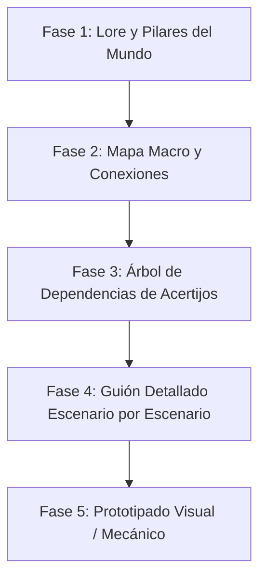

# Proyecto: Fortaleza Mecánica (Codename)
> **Game Design Document (GDD) — Base de Documentación y Guión**  
> *Fusión conceptual: El universo biomecánico de La Fortaleza (I & II) + La estética visual, táctil y narrativa muda de Machinarium.*

---

## 🎯 1. Visión General del Proyecto

- **Género:** Aventura gráfica de exploración y acertijos (*Point-and-Click / Puzzle Adventure* con exploración semi-abierta).
- **Inspiraciones Principales:**
  - **La Fortaleza (1990) & La Fortaleza II (1991):** El concepto de estar dentro de una colosal Bestia milenaria, leyes físicas alteradas (gravedad invertida, la cinta de Möbius, balanzas de equilibrio, criptogramas arcanos).
  - **Machinarium (Amanita Design):** Estética artística dibujada a mano, narrativa visual sin texto excesivo o con bocadillos de recuerdos/símbolos, interacción táctil rica, autómatas con carisma y melancolía.
- **Plataformas Objetivo:**
  - **PC (Steam):** Jugabilidad con ratón/teclado o gamepad, soporte de logros y gráficos en alta definición.
  - **Android (Google Play):** Experiencia táctil nativa idéntica (el género point-and-click / puzzles interactivos se adapta de forma inmejorable a pantallas táctiles sin botones virtuales molestos).
- **Motor Recomendado:** **Godot Engine 4** (2D/2.5D, liviano, exportación nativa impecable a Android y PC, libre de regalías).

---

## 🧭 2. Estructura de Documentación

Esta carpeta organiza paso a paso el desarrollo de la historia, el mundo y el diseño antes de escribir una sola línea de código:

1. [01_LORE_Y_NARRATIVA.md](file:///home/rfeynman/ws/fortaleza/docs/nuevo_juego/01_LORE_Y_NARRATIVA.md) — Mitología del mundo, protagonista, trasfondo de la Bestia Mecánica y premisa dramática.
2. [02_ESTRUCTURA_MUNDO_Y_MAPA.md](file:///home/rfeynman/ws/fortaleza/docs/nuevo_juego/02_ESTRUCTURA_MUNDO_Y_MAPA.md) — Cómo resolver el reto del **"Mundo Abierto"** en un juego de acertijos (Estructura de Hubs Interconectados).
3. [03_ACERTIJOS_Y_MECANICAS.md](file:///home/rfeynman/ws/fortaleza/docs/nuevo_juego/03_ACERTIJOS_Y_MECANICAS.md) — Filosofía de diseño de puzzles diegéticos, inventario y retos de lógica física.
4. `04_GUION_Y_ESCENARIOS.md` *(En desarrollo colaborativo)* — Desglose pantalla a pantalla de cinemáticas mudas, eventos y diálogos gestuales.

---

## 🗺️ 3. Hoja de Ruta Narrativa y Creativa

